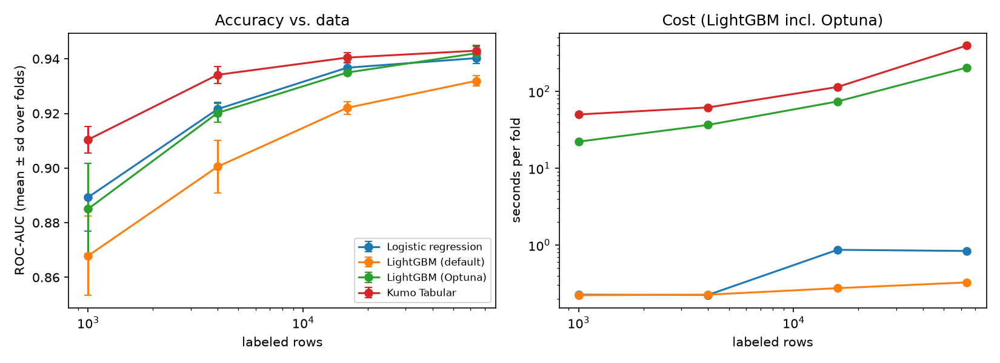

# Kumo Tabular vs. tuned LightGBM on credit card fraud

NVIDIA released [Kumo Tabular](https://huggingface.co/nvidia/Kumo-Tabular), a foundation model for tables. You give it labeled rows as context and it predicts new rows in a single forward pass, with no training and no hyperparameters. This compares it to gradient boosting when both get exactly the same labeled data and the boosting side is properly tuned.

Data: the Kaggle competition [Playground S6E11 · Predicting Credit Card Fraud](https://www.kaggle.com/competitions/playground-series-s6e11) (700k synthetic transactions, 1.7 % fraud, scored by ROC-AUC).

## How the comparison works

- Stratified 5-fold CV over all 700k training rows. In each fold I draw N rows from the four training folds. LightGBM trains on those N rows, Kumo gets the same N rows as context. Both then predict the full held-out fold (~140k rows, ~2.3k frauds).
- LightGBM is tuned with Optuna (40 trials, TPE + median pruning) using an inner 5-fold CV on the same N rows. The held-out fold is never seen during tuning.
- Kumo (`medium`, 8 estimators) gets no tuning.
- Logistic regression and an untuned LightGBM are there as reference points.

So at every N, all models see the same rows, and the Kumo vs. LightGBM difference is compared fold by fold.

## Results

ROC-AUC, mean over 5 folds:

| Labeled rows | Logistic reg. | LightGBM default | LightGBM + Optuna | Kumo Tabular |
|---:|---:|---:|---:|---:|
| 1,000 | 0.889 | 0.868 | 0.885 | **0.910** |
| 4,000 | 0.922 | 0.901 | 0.920 | **0.934** |
| 16,000 | 0.937 | 0.922 | 0.935 | **0.940** |
| 64,000 | 0.940 | 0.932 | 0.942 | 0.943 |

Kumo minus tuned LightGBM, per fold:

| Labeled rows | AUC difference | Kumo better in | p (paired t-test) |
|---:|---:|---:|---:|
| 1,000 | +0.025 | 5 of 5 folds | 0.02 |
| 4,000 | +0.014 | 5 of 5 folds | < 0.001 |
| 16,000 | +0.005 | 5 of 5 folds | < 0.001 |
| 64,000 | +0.001 | 3 of 5 folds | 0.13 |




- With the same data, Kumo is better up to 16k rows, in every fold. The smaller the data, the bigger the gap.
- At 64k rows they are tied. The advantage of the pretrained model shrinks as LightGBM gets enough data to learn the patterns itself.
- The other metrics point the same way. At 4k rows, for example, Kumo has a PR-AUC of 0.44 vs. 0.36 and catches 46 % vs. 40 % of frauds at a 1 % false positive rate. Its log loss is lower at every size, so its probabilities are also more usable as probabilities.
- Tuning matters for LightGBM: Optuna adds 0.01–0.02 AUC over the defaults. Without it, the comparison would look much better for Kumo than it should.
- Plain logistic regression keeps up with tuned LightGBM at every size. The data is synthetic and apparently very linear, so I dont know how this generalizes to real fraud data.
- Cost per fold on one GPU: Kumo took 50 s (1k rows) to 400 s (64k), LightGBM including Optuna 22 s to 200 s. Kumo isn't the cheap option, it's the no-effort option.

### Side notes

I couldn't do comparisions on the whole data or with `Kumo-large` because i only have access to trash GPUs.

## Run it

GPU machine (a plain script, works fine over SSH in `tmux`):

```bash
pip install -r requirements.txt
kaggle competitions download -c playground-series-s6e11 && unzip playground-series-s6e11.zip -d data/
python run_oof.py 2>&1 | tee results/run.log
```

Finished folds are cached in `results/oof/parts/`, so the same command resumes after an interruption. `python run_oof.py -h` lists the options (sizes, trials, Kumo size and context, `--no-full`, `--no-kumo`).

## Layout

```
run_oof.py   GPU run: out-of-fold predictions -> results/
kumo_fraud/  data loading and features, model wrappers (Kumo, LightGBM + Optuna, logistic regression), metrics
notebooks/   analysis.ipynb: per-fold scores, paired tests, plots
results/     per_fold_scores.csv, timings.csv, params.json, figures (raw predictions are not in the repo)
```
